# 🛒 فروشگاه اینترنتی جنگو (Django E-Commerce Shop)

یک پروژه فروشگاهی مدرن، ماژولار و مقیاس‌پذیر توسعه‌یافته با **Django** و **Python**، همراه با معماری تمیز اپ‌ها (`accounts`, `products`, `cart`, `orders`, `payment`)، طراحی کاملاً واکنش‌گرا و راست‌چین (RTL) با فونت وب **Vazirmatn**، و یکپارچه‌سازی‌شده با درگاه پرداخت **زرین‌پال (ZarinPal Sandbox)**.

---

## 🚀 ویژگی‌های کلیدی پروژه

- **سیستم احراز هویت سفارشی (`CustomUser`):** پشتیبانی از ثبت‌نام و ورود کاربران با استفاده از مدل کاربر سفارشی جنگو.
- **معماری ماژولار (Modular Apps):** جداسازی کامل مسئولیت‌ها در اپ‌های مستقل برای نگهداری و توسعه آسان‌تر.
- **مدیریت سبد خرید و سفارش‌ها:** قابلیت افزودن محصولات، محاسبه قیمت کل، و ثبت سفارش با شماره پیگیری اختصاصی برای هر کاربر.
- **درگاه پرداخت آنلاین:** اتصال به زرین‌پال، تبدیل تومان به ریال، اعتبارسنجی تراکنش‌ها و مدیریت پرداخت مجدد سفارش‌های ناموفق.
- **پنل مدیریت پیشرفته:** استفاده از پکیج **Django Unfold** برای داشتن یک ادمین‌پنل مدرن، زیبا و ریسپانسیو.
- **طراحی مدرن و واکنش‌گرا:** رابط کاربری فارسی با استایل‌های استاندارد و فونت زیبای **Vazirmatn**.

---

## 🛠 تکنولوژی‌های استفاده‌شده

- **Python 3.10+** & **Django 6.x**
- **django-environ** (مدیریت متغیرهای محیطی)
- **django-crispy-forms** & **crispy-bootstrap5** (فرم‌های بوت‌استرپی)
- **ZarinPal API** (درگاه پرداخت آنلاین)
- **SQLite / Database** & **Pillow** (مدیریت تصاویر)
- **Django Unfold** (رابط کاربری ادمین‌پنل)

---

## 📁 ساختار پروژه

```text
file_shop/
│
├── apps/
│   ├── accounts/       # احراز هویت و کاربران سفارشی
│   ├── cart/           # سبد خرید
│   ├── orders/         # مدیریت و تاریخچه سفارش‌های کاربران
│   ├── payment/        # درگاه پرداخت و سرویس‌های بانکی
│   └── products/       # محصولات، دسته‌بندی‌ها و جستجو
│
├── core/               # تنظیمات اصلی پروژه (settings.py, urls.py)
├── templates/          # قالب‌های HTML سراسری
├── assets/             # تصاویر و اسکرین‌شات‌های پروژه
├── manage.py           # فایل اجرایی جنگو
├── requirements.txt    # لیست پکیج‌های مورد نیاز
└── README.md
```

---

## 🖼 اسکرین‌شات‌های پروژه

بخشی از صفحات اصلی و پنل مدیریت فروشگاه:

### 🔐 ورود و ثبت‌نام

| ورود کاربران | ثبت‌نام کاربر جدید |
|:---:|:---:|
| 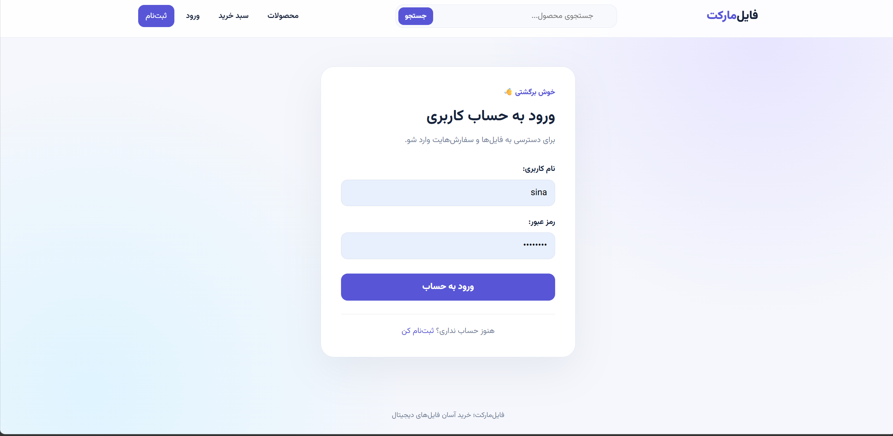 | 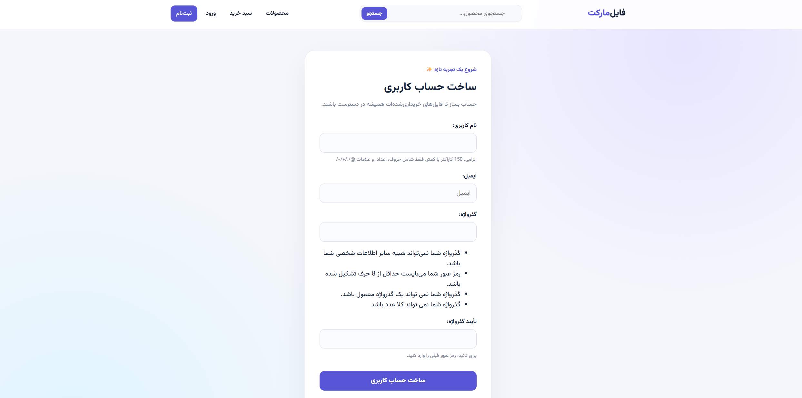 |

### 🏠 صفحه اصلی و محصولات

| صفحه اصلی فروشگاه | لیست محصولات |
|:---:|:---:|
| 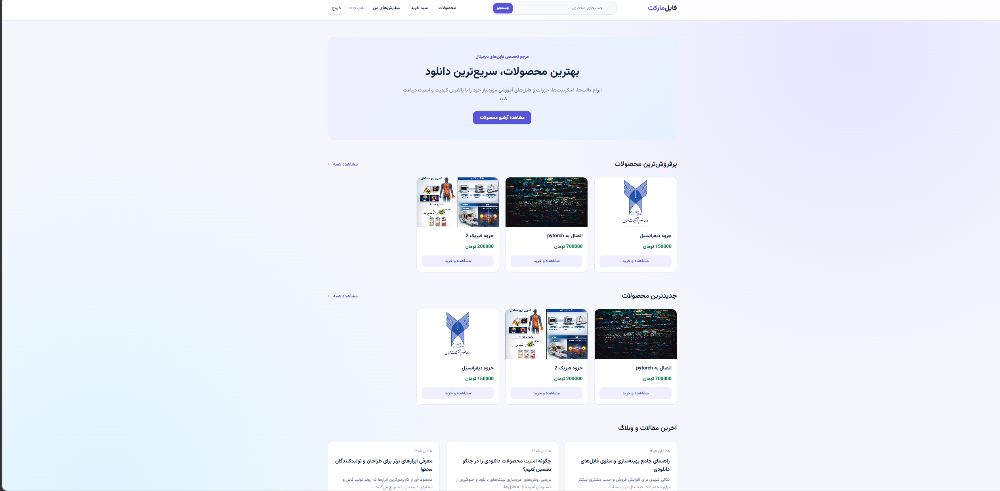 | 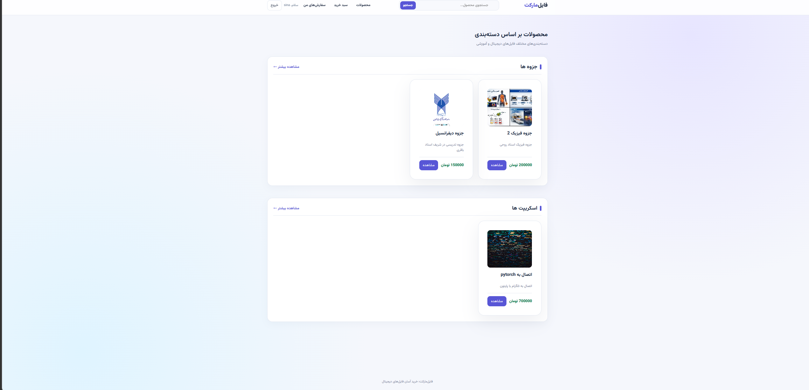 |

### 🔍 جزئیات محصول

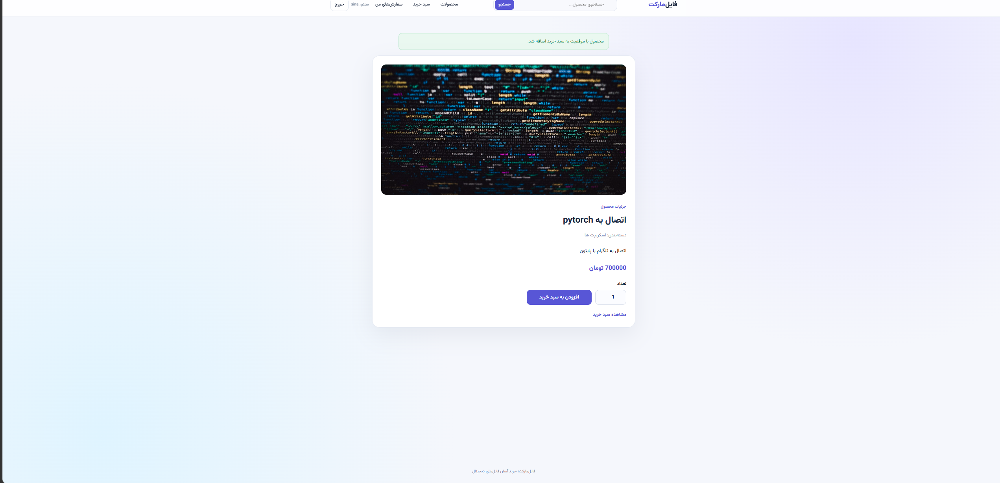

### 🛒 سبد خرید و پرداخت

| سبد خرید | فاکتور / تسویه‌حساب |
|:---:|:---:|
| 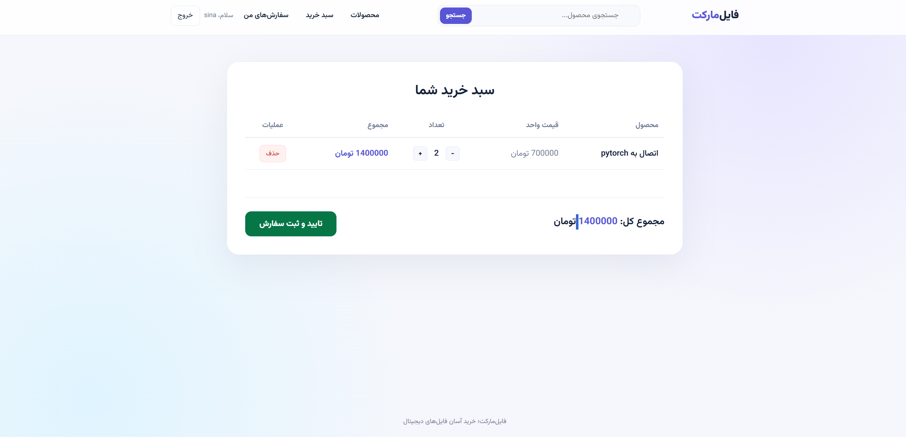 | 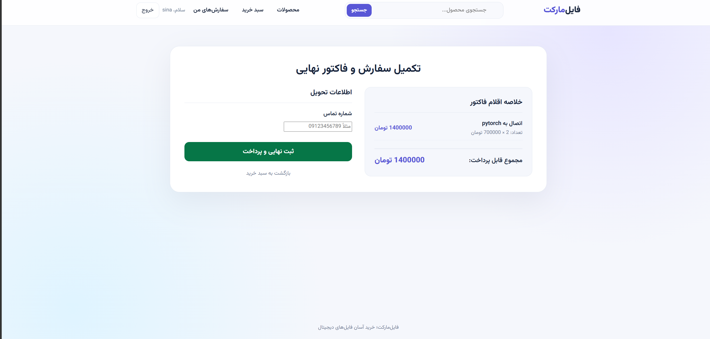 |

### 📦 سفارشات کاربر

**تاریخچه و لیست سفارش‌ها**

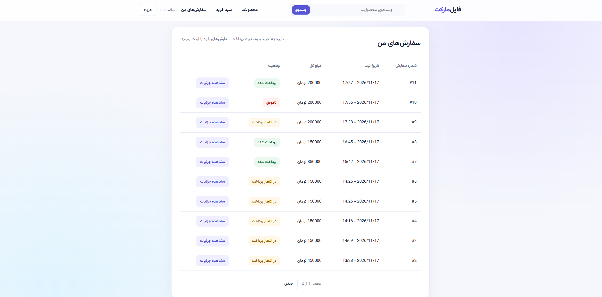

### ⚙️ پنل مدیریت (Django Unfold)

**داشبورد مدیریت**

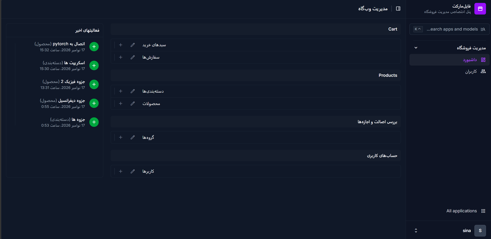

| مدیریت سفارش‌ها | فیلتر و جستجوی سفارش‌ها |
|:---:|:---:|
| 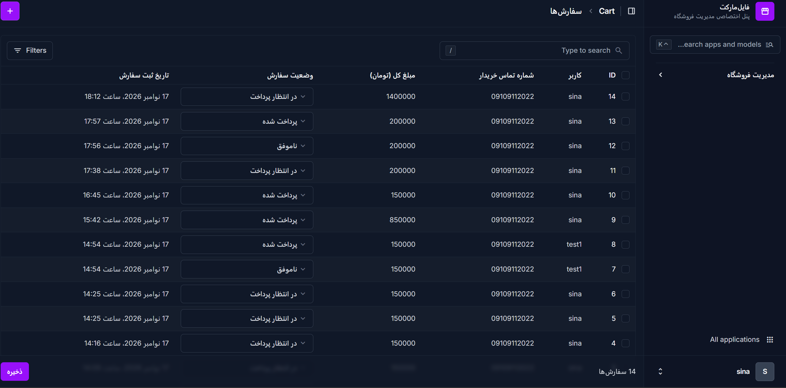 | 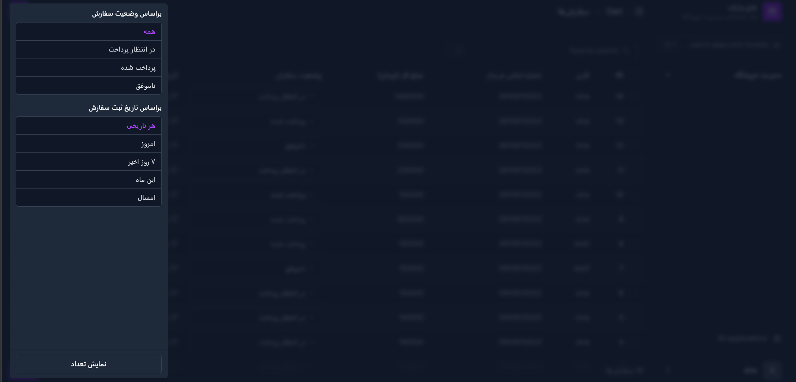 |

---

## 👨‍💻 توسعه‌دهنده

**Sina Samiei**

